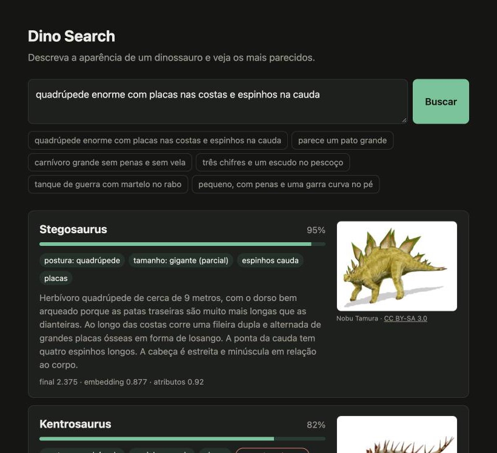
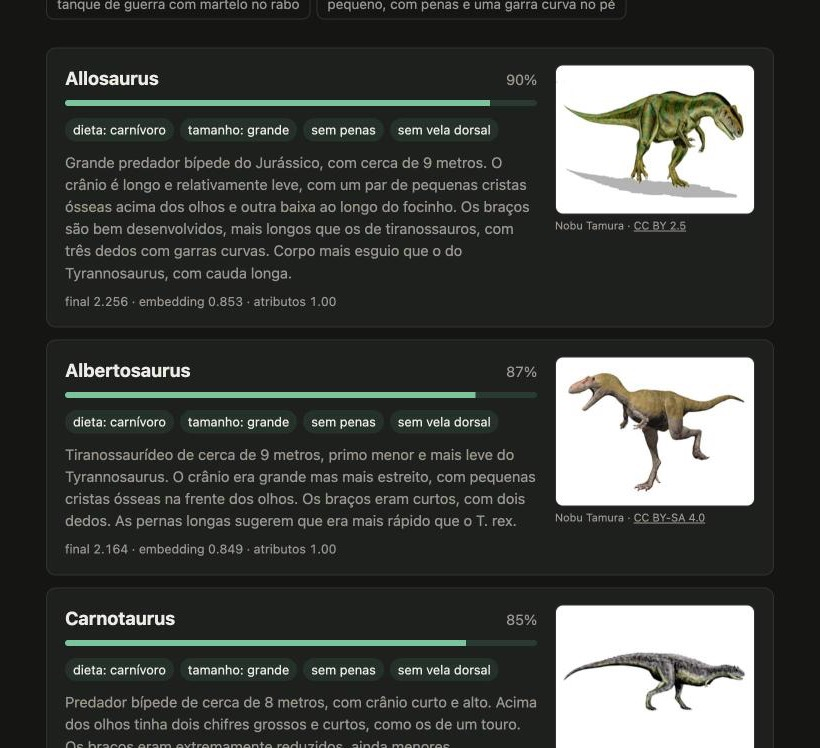

# Dino Search by Similarity

Semantic search that identifies dinosaurs from free-text physical descriptions written in
Portuguese. Type "quadrúpede enorme com placas nas costas e espinhos na cauda" ("huge
quadruped with plates on its back and spikes on its tail") and get the most similar
dinosaurs, each with a score and a per-trait explanation.

The search is a hybrid: dense retrieval with multilingual E5 embeddings, combined by late
score fusion with rule-based attribute extraction that handles negations ("sem penas",
"without feathers") and sizes, which embeddings alone get wrong.





The interface and the queries are in Portuguese, since that is the language the extractor
and the dataset target.

## Running

```bash
python3 -m venv .venv && source .venv/bin/activate
pip install -r requirements.txt
uvicorn app.main:app            # http://localhost:8000
```

On the first run the model (~1.1 GB) is downloaded and the dataset embeddings are computed
and saved to `.cache/`. Later runs reuse the cache; it is only rebuilt when
`data/dinos.json` or the model changes (the cache key is a hash of both).

```bash
pip install -r requirements-dev.txt
python -m app.search.dinos      # validate data/dinos.json
pytest                          # tests (the API test loads the model)
mypy app eval tests --ignore-missing-imports
python -m eval.run_eval         # results table for the three configurations
python -m eval.run_eval --grid  # β/γ weight sweep
python -m eval.run_eval --failures
python -m eval.run_eval --model sentence-transformers/paraphrase-multilingual-mpnet-base-v2
```

### API

- `POST /search` with `{"query": str, "top_k": int = 5}` returns a list with `nome`,
  `score_final`, `similaridade` (score_final scaled to [0, 1] for the bar), `score_embedding`
  (raw cosine), `score_atributos`, `penalidade`, `tracos_correspondentes` (matched traits),
  `tracos_nao_correspondentes` (missing traits), `tracos_conflitantes` (conflicting traits)
  and `descricao_fisica` (physical description).
- `GET /dinos` lists the dataset.
- `GET /` serves the front-end (`static/index.html`).
- `GET /img/<name>.png` serves the illustrations; `GET /img/credits.json` their credits.

## Layout

```
data/dinos.json            50 dinosaurs, closed vocabulary of 24 traits
app/search/dinos.py        loading + schema validation
app/search/embedder.py     E5 embeddings + NumPy index with disk cache
app/search/extractor.py    rule-based extraction of posture/diet/size/traits/negations
app/search/ranker.py       score fusion + per-trait explanation
app/config.yaml            model, aggregation, weights
app/main.py                FastAPI
static/index.html          front-end
static/img/                illustrations (PNG, 320 px) + credits.json
eval/queries.json          66 test queries
eval/run_eval.py           Top-1, Top-3, MRR
tests/                     pytest
docs/screenshots/          README screenshots
```

## Design decisions

**Data.** Each dinosaur has `tracos` (traits) as a list of `{"traco", "incerto"}` drawn from a
closed vocabulary (`TRAITS` in `dinos.py`), so queries match the dataset without ambiguity.
Debated traits carry `"incerto": true` (uncertain): feathers on Deinonychus, Utahraptor,
Gallimimus, Therizinosaurus and Compsognathus (inferred from relatives, no direct evidence);
Oviraptor (feathers inferred from relatives, and a crest that is poorly known from the
crushed holotype); and the semi-aquatic habits of Spinosaurus aegyptiacus. Inferred sails are
uncertain too: Ouranosaurus (sail or hump), Amargasaurus (skin sails or keratin spikes) and
Spinosaurus mirabilis, whose sail shape is unknown. Velociraptor (quill knobs on the ulna)
and Microraptor (preserved plumage) have feathers without the uncertainty flag. Other
debates go in the `notas` field (Spinosaurus aegyptiacus posture, validity of the genus
Brontosaurus, position of the Kentrosaurus side spike, immature material of Spinosaurus
mirabilis).

The dataset holds the original list of 30 dinosaurs plus 20 more: Spinosaurus mirabilis
(described by Sereno et al. in *Science*, February 2026), Ceratosaurus, Albertosaurus,
Majungasaurus, Coelophysis, Herrerasaurus, Suchomimus, Yutyrannus, Archaeopteryx,
Ouranosaurus, Maiasaura, Lambeosaurus, Pachyrhinosaurus, Psittacosaurus, Euoplocephalus,
Borealopelta, Apatosaurus, Camarasaurus, Amargasaurus and Mamenchisaurus. Several were picked
because they create useful confusions for the evaluation: Ouranosaurus is a herbivore with a
sail, Euoplocephalus also has a tail club, Suchomimus also has a crocodile-like snout, and
Pachyrhinosaurus is a ceratopsian without horns. Size categories are validated against
length: small < 2.5 m, medium < 7.5 m, large < 15 m, giant above that.

**Model.** `intfloat/multilingual-e5-base`, with the `query:` and `passage:` prefixes. It was
trained for asymmetric retrieval (short query against a longer passage), which is exactly
this task. In the evaluation it clearly beat `paraphrase-multilingual-mpnet-base-v2` in
embeddings-only mode (MRR 0.807 vs 0.616).

**Dense retrieval.** The description and every paraphrase are separate vectors (251 in
total). A dinosaur's score is the mean of its 2 best vectors (`top2_mean`), which beat the
max (MRR 0.807 vs 0.753 embeddings-only, 0.967 vs 0.944 hybrid): a single vector that
happens to be close counts for less. The index is a NumPy matrix product isolated in
`DenseIndex`, which is where FAISS or pgvector would go if the dataset grew.

**Extractor.** A regex synonym lexicon over lowercased, accent-stripped text (`"corno"` and
`"pontas na testa"` become `chifres`, horns; `"martelo no rabo"`, "hammer on the tail",
becomes `clava_cauda`, tail club). For traits the longest match wins (`"bico de pato"`, duck
bill, beats `"bico"`, beak). Negation: a cue (`sem`, `não tem`, `nenhum`, i.e. "without",
"doesn't have", "no") negates the first trait within 3 words after it, plus traits chained
by `e`/`nem`/`ou` ("and"/"nor"/"or"), and stops at `com`/`mas` ("with"/"but") or a comma. So
"sem espinhos no escudo" ("no spikes on the frill") negates only `espinhos`. A bare "não"
("not") does not negate traits ("não sei, tem chifres", "I don't know, it has horns"), but it
cancels a diet, posture or size right after it ("não é carnívoro", "it's not a carnivore",
leaves the diet unset instead of matching carnivore). Size adjectives inside or right after a
trait don't count as the animal's size ("garras gigantes", "giant claws"). Explicit
comparisons ("do tamanho de um urso", "the size of a bear") take priority over adjectives.
To swap in an LLM, any `Callable[[str], QueryAttrs]` registered in `get_extractor` works;
`QueryAttrs.from_dict` validates the LLM's JSON against the vocabulary.

**Fusion (late fusion).**
`score_final = α · normalized_dense + β · attribute_match − γ · negation_penalty`

- `normalized_dense`: cosine rescaled per query to [0, 1] (min-max across the 50 dinosaurs).
  E5 cosines sit in a narrow band (~0.75 to 0.9); without this the weights wouldn't be
  comparable.
- `attribute_match`: the mean over the attributes the query mentions. A present trait scores
  1 (0.75 if uncertain). Posture and diet score 1 when equal and 0.5 when compatible
  (facultative vs biped, piscivore vs carnivore, omnivore vs either); 0 counts as a conflict.
  Size is ordinal: 1 − distance/3.
- `negation_penalty`: +1 for each negated trait the dinosaur has (+0.5 if uncertain).
- Name: if the query contains words from a dinosaur's name, the fraction of the name present
  becomes one more attribute. "spinosaurus" matches half of the name of both species (a tie
  that the dense score breaks in favour of *aegyptiacus*); "spinosaurus mirabilis" matches
  one species fully. Embeddings alone don't read scientific names well. A name used as a
  reference ("parecido com um Triceratops mas sem chifres", "like a Triceratops but without
  horns") doesn't hurt, because the negation costs more than the name earns.

**Chosen weights: α = 1.0, β = 1.5, γ = 1.0.** The sweep (`--grid`) shows a plateau at
MRR 0.967 for every β ≥ 1.5 and γ ≥ 0.5. Below it quality drops (β = γ = 0.25: MRR 0.931;
β = 1, γ = 0.5: 0.960; γ = 0 at any β: 0.932, i.e. negations break without the penalty). The
plateau and the choice stayed the same when the dataset grew from 30 to 50 dinosaurs. I
picked the left edge of the plateau, the smallest attribute weight that reaches the
maximum, so the dense score stays as influential as possible. Out of a maximum of 2.5
points, 40% comes from embeddings and 60% from the rules. In practice the attributes sort
dinosaurs into bands, the dense score orders them within each band, and it decides alone
when the extractor recognizes nothing (then `attribute_match` is 0 for everyone and the
hybrid becomes embeddings-only).

**Explainability.** Each result lists the traits that matched (marked `(parcial)`, partial,
for partial matches such as an uncertain trait or an adjacent size), the ones that didn't,
and the ones that conflict (incompatible posture or diet, size 2+ categories away, a negated
trait that is present).

## Results

66 queries in `eval/queries.json`: 22 direct, 21 lay/vague, 14 with negation and 9 ambiguous
(several acceptable answers; the first hit counts). E5-base model, `top2_mean` aggregation.

| configuration | Top-1 | Top-3 | MRR |
|---|---|---|---|
| embeddings only | 0.712 | 0.894 | 0.807 |
| attributes only | 0.727 | 0.833 | 0.792 |
| **hybrid** (α=1, β=1.5, γ=1) | **0.939** | **1.000** | **0.967** |

MRR by query type:

| configuration | direct | lay | negation | ambiguous |
|---|---|---|---|---|
| embeddings only | 0.932 | 0.823 | 0.568 | 0.837 |
| attributes only | 0.790 | 0.727 | 0.826 | 0.897 |
| hybrid | 0.977 | 0.952 | 0.952 | 1.000 |

Model comparison (hybrid with the same weights):

| model | embeddings only (MRR) | hybrid (MRR) |
|---|---|---|
| multilingual-e5-base | 0.807 | 0.967 |
| paraphrase-multilingual-mpnet-base-v2 | 0.616 | 0.908 |

What the numbers show: plain embeddings do well on direct descriptions but break on negation
(0.568), because "sem penas" ("without feathers") lands close to the feathered dinosaurs.
The attributes fix negation and ambiguity, but on their own they can't separate dinosaurs
that share the same set of traits. That got worse going from 30 to 50 dinosaurs
(attributes-only MRR fell from 0.903 to 0.792), because more dinosaurs now share traits. The
hybrid combines both and dropped much less (0.981 to 0.967).

When the dataset grew, some older queries gained new answers that are equally correct (for
example Suchomimus for "come peixe", "eats fish", and Euoplocephalus for "tatu gigante com
martelo no rabo", "giant armadillo with a hammer on its tail"), and "parecido com um
Triceratops mas sem chifres" ("like a Triceratops but without horns") now also accepts
Pachyrhinosaurus, which is literally that.

Remaining hybrid misses (top-1), left as they are so the lexicon isn't tuned to the test:
- "crista tubular longa curvada para trás e bico achatado" (long tubular crest curving back,
  flat beak): Corythosaurus 1st, Parasaurolophus 2nd. The lexicon doesn't capture crest
  shape.
- "girafa pré-histórica" (prehistoric giraffe): Mamenchisaurus 1st, Brachiosaurus 2nd.
  "Girafa" maps only to `pescoco_longo` (long neck), not to the sloped posture.
- "minúsculo, cabe no colo e come lagartos" (tiny, fits on your lap, eats lizards):
  Archaeopteryx 1st, Compsognathus 2nd.
- "ceratopsiano sem chifres com uma placa grossa no nariz" (hornless ceratopsian with a thick
  plate on the nose): Pachyrhinosaurus 3rd. "Placa" maps to `placas` (Stegosaurus-style
  plates), a lexicon false positive.

### Embedding hub: Dilophosaurus

On generic carnivore queries ("carnívoro de duas patas", "predador bípede"), every theropod
ties on attributes and the dense score breaks the tie. Dilophosaurus won almost every time
(top-3 in 8 of 16 generic queries) because two of its five passages were generic ("predador
magro com crista dupla", "Predador bípede esguio...", "slim predator...", "slender bipedal
predator..."), and averaging the 2 best rewarded that. A global hubness correction
(subtracting each dinosaur's mean similarity to the other dinosaurs' paraphrases) barely
helped (8 to 6), because the problem was local to the carnivore group. The fix was in the
data: its passages now describe the double crest instead of "two-legged predator". Result:
0 of 16, hybrid unchanged (0.967), and embeddings-only fell from 0.814 to 0.800 because part
of its accuracy came from the hub itself. Rule for new entries: paraphrases should describe
what sets the animal apart, not its category.

The same happened between the two *Spinosaurus* species: "espinossauro" and "spinosaurus"
returned *mirabilis* first, because only its passages used the name ("espinossauro com
crista...", "parente do Spinosaurus..."). *Aegyptiacus* now has the common name in its
passages ("o espinossauro clássico", "the classic spinosaur"), and the name matching above
handles full names. Of 18 queries describing the classic spinosaur, 17 return *aegyptiacus*
first (the exception, "terópode de 14 metros...", fails because the extractor doesn't read
metres).

### Tried and dropped

Stripping negated phrases from the query before embedding it ("carnívoro grande sem penas"
becomes "carnívoro grande") seemed obvious, but it changed nothing with the final weights
(MRR 0.981 both ways, measured on the 30-dinosaur dataset) and made negations worse at low β.
It was removed.

### Limitations

- **Author bias.** The dataset, paraphrases, lexicon and test queries were all written by
  the same author (the model that generated the project). The queries use different
  vocabulary from the paraphrases, but the extractor lexicon was written knowing the queries,
  and the weights were tuned on the same set. The attributes-only and hybrid numbers are
  optimistic. An honest evaluation needs queries written by other people.
- The extractor ignores negated posture or diet ("não é carnívoro" only leaves the diet
  unset; it doesn't penalize carnivores), and only understands size comparisons from a fixed
  list. It doesn't read measurements in metres.
- The dense score is normalized per query (min-max), so the top result always gets 1 on the
  dense component, even for a nonsense query. The displayed `similaridade` is relative to the
  best score possible for that query, not a probability.
- `DenseIndex` is a single concrete class. Moving to FAISS means rewriting `scores()` (the
  matrix product and the aggregation) without touching the rest.
- 50 items: brute-force NumPy is the right call here; `DenseIndex` exists for the day it
  isn't.

## Illustration credits

The illustrations in `static/img/` come from [Wikimedia Commons](https://commons.wikimedia.org/),
downscaled to 320 px wide and converted to PNG. All are Creative Commons licensed (CC BY or
CC BY-SA); the adaptations carry the same license as the original. Author, license and link
for each one also appear on the card and in `static/img/credits.json`.

| dinosaur | author | license |
|---|---|---|
| Tyrannosaurus | Nobu Tamura | [CC BY-SA 4.0](https://commons.wikimedia.org/wiki/File:Tyrannosaurus_rex_Reconstruction_by_Nobu_Tamura.jpg) |
| Triceratops | Nobu Tamura | [CC BY 2.5](https://commons.wikimedia.org/wiki/File:Triceratops_BW.jpg) |
| Velociraptor | Nobu Tamura | [CC BY 2.5](https://commons.wikimedia.org/wiki/File:Velociraptor_mongoliensis.jpg) |
| Stegosaurus | Nobu Tamura | [CC BY-SA 3.0](https://commons.wikimedia.org/wiki/File:Stegosaurus_BW_transparent.png) |
| Brachiosaurus | Nobu Tamura | [CC BY-SA 4.0](https://commons.wikimedia.org/wiki/File:Brachiosaurus_NT_new.jpg) |
| Spinosaurus aegyptiacus | Nobu Tamura | [CC BY-SA 4.0](https://commons.wikimedia.org/wiki/File:Spinosaurus_life_restoration_with_Onchopristis.jpg) |
| Ankylosaurus | Emily Willoughby | [CC BY-SA 3.0](https://commons.wikimedia.org/wiki/File:Ankylosaurus_magniventris_reconstruction.png) |
| Parasaurolophus | Connor Ashbridge | [CC BY-SA 4.0](https://commons.wikimedia.org/wiki/File:Life_reconstruction_of_Parasaurolophus_walkeri.png) |
| Pachycephalosaurus | Fred Wierum | [CC BY-SA 4.0](https://commons.wikimedia.org/wiki/File:Pachycephalosaurus_Reconstruction_transparent.png) |
| Allosaurus | Nobu Tamura | [CC BY 2.5](https://commons.wikimedia.org/wiki/File:Allosaurus_BW.jpg) |
| Diplodocus | Nobu Tamura | [CC BY 3.0](https://commons.wikimedia.org/wiki/File:Diplodocus_BW.jpg) |
| Iguanodon | Nobu Tamura | [CC BY-SA 4.0](https://commons.wikimedia.org/wiki/File:Iguanodon_new_NT_transparent.png) |
| Brontosaurus | Nobu Tamura | [CC BY-SA 4.0](https://commons.wikimedia.org/wiki/File:Brontosaurus_NT_small.jpg) |
| Dilophosaurus | Nobu Tamura | [CC BY-SA 4.0](https://commons.wikimedia.org/wiki/File:Dilophosaurus_NT.jpg) |
| Carnotaurus | Nobu Tamura | [CC BY 3.0](https://commons.wikimedia.org/wiki/File:Carnotaurus_BW.jpg) |
| Giganotosaurus | Nobu Tamura | [CC BY 2.5](https://commons.wikimedia.org/wiki/File:Giganotosaurus_BW.jpg) |
| Baryonyx | Nobu Tamura | [CC BY 2.5](https://commons.wikimedia.org/wiki/File:Baryonyx_BW.jpg) |
| Gallimimus | PaleoNeolitic | [CC BY 4.0](https://commons.wikimedia.org/wiki/File:Gallimimus_Restoration.png) |
| Compsognathus | Nobu Tamura | [CC BY 2.5](https://commons.wikimedia.org/wiki/File:Compsognathus_BW.jpg) |
| Oviraptor | PaleoNeolitic | [CC BY 4.0](https://commons.wikimedia.org/wiki/File:Oviraptor_Restoration.png) |
| Therizinosaurus | Nobu Tamura | [CC BY-SA 4.0](https://commons.wikimedia.org/wiki/File:Therizinosaurus_NT.jpg) |
| Microraptor | Fred Wierum | [CC BY-SA 4.0](https://commons.wikimedia.org/wiki/File:Microraptor_Restoration.png) |
| Deinonychus | Nobu Tamura | [CC BY 2.5](https://commons.wikimedia.org/wiki/File:Deinonychus_BW.jpg) |
| Utahraptor | Nobu Tamura | [CC BY 2.5](https://commons.wikimedia.org/wiki/File:Utahraptor_BW.jpg) |
| Edmontosaurus | Nobu Tamura | [CC BY 2.5](https://commons.wikimedia.org/wiki/File:Edmontosaurus_BW.jpg) |
| Styracosaurus | Nobu Tamura | [CC BY-SA 3.0](https://commons.wikimedia.org/wiki/File:Styracosaurus_BW_transparent.png) |
| Argentinosaurus | Nobu Tamura | [CC BY 3.0](https://commons.wikimedia.org/wiki/File:Argentinosaurus_BW.jpg) |
| Protoceratops | Nobu Tamura | [CC BY 2.5](https://commons.wikimedia.org/wiki/File:Protoceratops_BW.jpg) |
| Corythosaurus | Connor Ashbridge | [CC BY-SA 4.0](https://commons.wikimedia.org/wiki/File:Life_reconstruction_of_Corythosaurus_casuarius.png) |
| Kentrosaurus | Nobu Tamura | [CC BY-SA 3.0](https://commons.wikimedia.org/wiki/File:Kentrosaurus_NT_transparent.png) |
| Spinosaurus mirabilis | Connor Ashbridge | [CC BY 4.0](https://commons.wikimedia.org/wiki/File:Spinosaurus_mirabilis.png) |
| Ceratosaurus | Nobu Tamura | [CC BY-SA 3.0](https://commons.wikimedia.org/wiki/File:Ceratosaurus_NT.jpg) |
| Albertosaurus | Nobu Tamura | [CC BY-SA 4.0](https://commons.wikimedia.org/wiki/File:Albertosaurus_NT_small.jpg) |
| Majungasaurus | Nobu Tamura | [CC BY 2.5](https://commons.wikimedia.org/wiki/File:Majungasaurus_BW.jpg) |
| Coelophysis | TotalDino | [CC BY-SA 4.0](https://commons.wikimedia.org/wiki/File:Coelophysis_TD.png) |
| Herrerasaurus | Nobu Tamura | [CC BY 2.5](https://commons.wikimedia.org/wiki/File:Herrerasaurus_BW.jpg) |
| Suchomimus | Nobu Tamura | [CC BY 3.0](https://commons.wikimedia.org/wiki/File:Suchomimus_BW.jpg) |
| Yutyrannus | Tomopteryx | [CC BY-SA 4.0](https://commons.wikimedia.org/wiki/File:Yutyrannus_huali.png) |
| Archaeopteryx | Nobu Tamura | [CC BY-SA 3.0](https://commons.wikimedia.org/wiki/File:Archaeopteryx_NT.jpg) |
| Ouranosaurus | Audrey.m.horn | [CC BY-SA 4.0](https://commons.wikimedia.org/wiki/File:Ouranosaurus_nigeriensis_restoration.png) |
| Maiasaura | Nobu Tamura | [CC BY 3.0](https://commons.wikimedia.org/wiki/File:Maiasaura_BW.jpg) |
| Lambeosaurus | Anonymous Dinonerd | [CC BY-SA 4.0](https://commons.wikimedia.org/wiki/File:Life_restoration_of_Lambeosaurus_lambei.jpg) |
| Pachyrhinosaurus | Nobu Tamura | [CC BY-SA 3.0](https://commons.wikimedia.org/wiki/File:Pachyrhinosaurus_BW_flipped_transparent.png) |
| Psittacosaurus | Nobu Tamura | [CC BY-SA 3.0](https://commons.wikimedia.org/wiki/File:Psittacosaurus_sibiricus_whole_BW_transparent.png) |
| Euoplocephalus | Nobu Tamura | [CC BY-SA 3.0](https://commons.wikimedia.org/wiki/File:Euoplocephalus_BW_transparent.png) |
| Borealopelta | Connor Ashbridge | [CC BY 4.0](https://commons.wikimedia.org/wiki/File:Borealopelta_markmitchelli.png) |
| Apatosaurus | Durbed | [CC BY-SA 3.0](https://commons.wikimedia.org/wiki/File:Apatosaurus_louisae_by_durbed.jpg) |
| Camarasaurus | Nobu Tamura | [CC BY 3.0](https://commons.wikimedia.org/wiki/File:Camarasaurus_BW.jpg) |
| Amargasaurus | Nobu Tamura | [CC BY-SA 4.0](https://commons.wikimedia.org/wiki/File:Amargasaurus_NT_small.jpg) |
| Mamenchisaurus | Connor Ashbridge | [CC BY 4.0](https://commons.wikimedia.org/wiki/File:Mamenchisaurus_sanjiangensis.png) |
